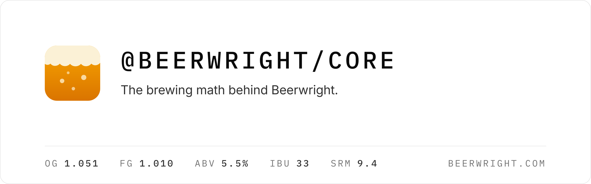

<picture>
  <source media="(prefers-color-scheme: dark)" srcset="brand/banner-dark.png">
  
</picture>

[API reference](https://beerwright.github.io/core/) · [Method notes](docs/README.md) · [Beerwright](https://beerwright.com)

[](https://github.com/beerwright/core/blob/main/LICENSE)
[](https://github.com/beerwright/core/actions/workflows/docs.yml)
[](https://beerwright.github.io/core/)

This is the brewing math behind [Beerwright](https://beerwright.com): gravity,
bitterness, color, ABV, water chemistry and mash pH, carbonation, yeast
pitching, decoctions and blending. It's the same code the app runs, copied
here from the app's repository every time a new version goes live.

I'm publishing it because I want to share a solid base for anyone who wants
to build brewing software, so we don't all have to reinvent the wheel. If
you're writing a brewing app, a calculator or a tool for your own brewery,
you're welcome to use it.

## What's in the box

From grain to glass:

| Area | What it works out |
| --- | --- |
| **Gravity and ABV** | Extract from the grist, mash and brewhouse efficiency, OG and FG, attenuation, calories, and ABV by the *Zymurgy* formula or the simple `(OG − FG) × 131.25` |
| **Bitterness** | Tinseth, Rager and Garetz, whirlpool and hop-stand additions corrected for temperature, and the alpha acid a hop loses in storage |
| **Color** | Morey, Daniels and Mosher, in SRM and EBC, with a hex swatch for the beer |
| **Water and mash pH** | Salt additions ion by ion, acid additions, a solver that picks the salts for a target profile, and a mash pH prediction from the grist |
| **Volumes** | Strike and sparge water, losses and boil-off, worked from the batch size or back from what you measured, plus strike temperature and infusions |
| **Corrections** | Refractometer and hydrometer readings, and how much to dilute or boil down to hit a gravity |
| **Yeast** | Pitch rates, viability by age, starters and dry-yeast sachets |
| **Decoction** | How much to pull for each decoction, and a schedule for the whole mash |
| **Carbonation and priming** | CO₂ volumes from keg pressure and temperature, the CO₂ left from fermentation, and priming sugar for bottles |
| **Blending** | Sours and barrel-aged blends: ABV, gravity, pH and acidity by volume, and priming that counts the CO₂ already in each component |
| **Mead, cider and spirits** | Honey or sugar to a target gravity, TOSNA nutrient schedules, sulfite and sorbate doses, and proofing and sweetening a spirit |
| **Recipe checks** | One pass before brew day for undersized equipment, a short pitch, mash pH out of range and the like |

## What it is

It's a TypeScript library with no runtime dependencies. It doesn't touch the
DOM, the network or the disk: you give it a recipe and it gives you numbers.
That's why the same code runs in the browser, on the server and in the tests
without any changes.

Every headline number comes with an explanation: the formula it used, the
inputs it plugged in, and the papers or books the formula is from. The app
shows these when you open the working behind a number, and you can read them
here too.

## A quick example

```ts
import { calculateRecipe } from './src';

const result = calculateRecipe({
  batchVolumeL: 20,
  boilTimeMinutes: 60,
  fermentables: [
    { name: 'Pale ale malt', amountKg: 4.5, class: 'grain', use: 'mash',
      extractFineGrindDryBasisPercent: 80, moisturePercent: 4, colorLovibond: 3 },
    { name: 'Crystal 60', amountKg: 0.4, class: 'steeping-grain', use: 'mash',
      extractFineGrindDryBasisPercent: 74, moisturePercent: 4, colorLovibond: 60 },
  ],
  hops: [
    { name: 'Centennial', amountKg: 0.02, alphaAcidPercent: 9.5, form: 'pellet',
      use: 'boil', timeMinutes: 60 },
    { name: 'Cascade', amountKg: 0.03, alphaAcidPercent: 6, form: 'pellet',
      use: 'boil', timeMinutes: 15 },
  ],
  yeasts: [{ name: 'US-05', type: 'ale', form: 'dry',
    attenuationMinPercent: 78, attenuationMaxPercent: 82 }],
});

result.vitals.og;            // 1.0508
result.vitals.fg;            // 1.0098
result.vitals.abv;           // 5.47
result.vitals.ibu;           // 33.0
result.vitals.srm;           // 9.4

result.explain.ibu.formula;  // 'tinseth-1997'
result.explain.ibu.sources;  // Tinseth 1997, Malowicki 2005, …
```

Here's the whole explanation behind that 33 IBU, as `result.explain.ibu`
returns it:

```json
{
  "label": "Bitterness",
  "formula": "tinseth-1997",
  "expression": "IBU = 1.65 × 0.000125^(Gb−1) × (1 − e^(−0.04t))/4.15 × (AA% × g × 1000 / L)",
  "inputs": {
    "volumeL": 21.3,
    "volumeBasis": "post-boil",
    "boilGravity": 1.0508,
    "gravityBasis": "post-boil",
    "whirlpoolModel": "mibu",
    "hopCount": 2
  },
  "value": 33.03692212896646,
  "unit": "IBU",
  "notes": ["Dry hops contribute 0 IBU."],
  "sources": [
    {
      "title": "Hop Utilization",
      "author": "Glenn Tinseth",
      "year": 1997,
      "url": "http://realbeer.com/hops/research.html"
    },
    {
      "title": "Hop bitter acid isomerization and degradation kinetics in a model wort-boiling system",
      "author": "Mark G. Malowicki, MSc thesis, Oregon State University",
      "year": 2005
    },
    {
      "title": "A Modified IBU Calculation, especially for late hopping and whirlpool hops",
      "author": "John-Paul Hosom (alchemyoverlord)",
      "year": 2018,
      "url": "https://alchemyoverlord.wordpress.com/"
    }
  ],
  "family": "bitterness"
}
```

The OG, FG, ABV, color, BU:GU, calories, efficiency and volumes come with
one of these too.

Everything is in metric internally (kilograms, liters, °C, specific gravity),
and `src/units` converts at the edges. When you leave something out, like the
equipment profile above, the engine uses a documented default. Those are all
in `src/defaults.ts`, each with a note on where its number came from.

## Where things are

- `src/recipe.ts` has `calculateRecipe`, which is the place to start. It calls
  everything else.
- Each area has its own module: `gravity`, `ibu`, `color`, `abv`, `water`,
  `mashPh`, `waterSolver`, `carbonation`, `yeast`, `starter`, `decoction`,
  `blending` and a few more.
- `src/sources.ts` is the bibliography. Every citation in the explanations
  comes from there.
- `docs/` explains the methods in prose: which formula runs where, what it
  assumes, and what it leaves out.
- The [API reference](https://beerwright.github.io/core/) is generated
  from the comments in the code.

Where there's more than one published answer, you can choose. Tinseth is the
default for IBU, with Rager and Garetz available. Morey is the default for
color, with Daniels and Mosher available. For ABV, the default is the more
accurate formula from *Zymurgy*, and the simple `(OG − FG) × 131.25` is
available too. The result always says which one it used.

## Running it

```sh
pnpm install
pnpm test
pnpm typecheck
pnpm run docs    # the API reference, into site/
```

The tests check the math against figures worked out by hand, against
published recipes, and against properties that should always hold (scaling a
recipe shouldn't change its gravity, for example).

## Issues and pull requests

If you think a number is wrong, please open an issue. The most useful ones
say what you expected, what the engine gave you, and where your number comes
from: a book, a paper, a lab sheet or a measurement.

I'm not taking pull requests here for now. This repository is a copy of code
that lives in Beerwright's own repository, so a change made here would be
overwritten on the next sync. If you've found a fix, open an issue with it
and I'll make the change in the main repository and credit you as a
co-author. It'll show up here on the next release.

## License

Apache 2.0. See `LICENSE`.

Chris Main
